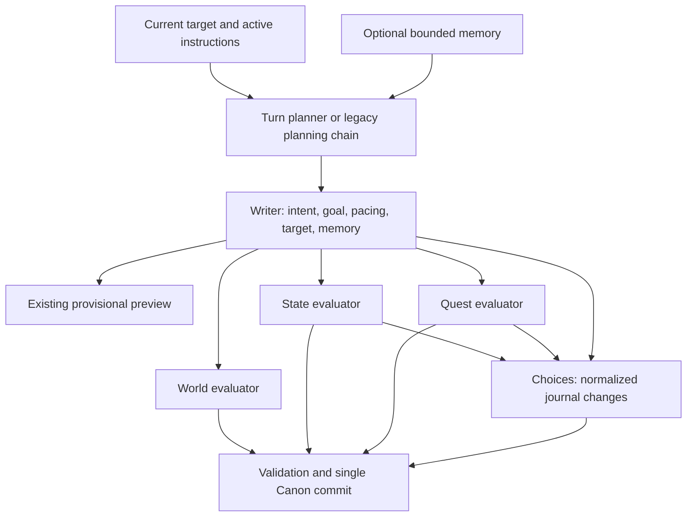

# Stage 3.2 — dependency and parallelism audit

## Decision

Keep current generation scheduling. The hosted path already starts independent
post-writer evaluators concurrently and starts choices as soon as its state and
quest inputs are available. Preserving those inputs leaves less than 1 ms of
recorded post-writer inter-call overhead in each of the twelve baseline turns.
There is no evidenced latency win from rescheduling this unchanged DAG.

This increment adds an offline schedule analyzer and regression coverage. It
changes neither production scheduling, provider routing, active settings nor
prompts. No new remote model run is needed to reanalyze the existing timestamps;
this is not presented as a new before/after provider experiment.

## Input/output dependency graph



| Step | Inputs that prevent an earlier start | Outputs consumed later |
| --- | --- | --- |
| Legacy action interpreter | Player action and authoritative target | Intent for director/pacing/writer/evaluators |
| Legacy director | Interpreted intent, instructions, target, memory | Goal for pacing/writer/quest |
| Legacy pacing | Intent and director goal | Structural decision normalized by Go |
| Turn planner | Action, target, instructions, memory | Intent, goal and structural decision in one existing call |
| Writer | Planning results, authoritative target, instructions, memory | Final candidate beat |
| World | Candidate beat, action/intent, pacing, current cast/world | Validated entity mutations |
| State | Candidate beat, action/intent, current journal | Validated inventory/ability/currency changes |
| Quest | Candidate beat, action/intent, goal, current objectives | Validated objective mutations |
| Choices | Candidate beat, current state and normalized state/quest mutations | Exactly four candidate actions |
| Canon commit | All validated mutations and choices; expected head | One atomic event batch |

The three evaluator calls do not consume one another's results. World
extraction is not an input to choices. State and quest changes are inputs to
choices: dropping them can propose spending an exhausted resource or pursuing a
just-completed objective. Merely removing these fields would change behavior and
would require a distinct correctness and quality experiment.

The optional extractor path already starts extraction and choices concurrently;
its choices intentionally use authoritative state and the candidate beat, with
pending extraction changes excluded. That is a separate existing contract, not
a reason to drop inputs from the ordinary evaluator path. On failures, all
started branches must finish before the turn returns, and no Canon batch may be
committed. A cancellation also drains the in-flight requests.

`llmpolicy.SupportsParallelRequests` still enables hosted fan-out only for
`google_gemini`. The ordinary local OpenAI-compatible/llama.cpp path remains
sequential. No automatic provider concurrency expansion was introduced.

## Recorded scheduling and bounds

[Source full-turn baseline](benchmarks/turn-configured-baseline-2026-11-09.json),
[derived schedule analysis](benchmarks/turn-schedule-analysis-2026-11-09.json).
The analyzer records the source SHA-256 and preserves the original file.
All twelve successful rows qualified for the six-call planner model.

Let `W`, `S`, `Q`, `C` be the recorded world, state, quest and choices call
durations. The duration-only post-writer dependency floor is
`max(W, max(S, Q) + C)`. Observed post-writer time is the end of the later world
or choices call minus writer completion. Their difference includes Go
validation, observer overhead and request-launch gaps; it is not an isolated OS
scheduler measurement. It also excludes final validation/commit after the last
provider call.

| Memory | World critical turns | Quest/state → choices critical turns | Gap median / max, ms | Overlap versus serial median, s | Independent choices bound median / max, s |
| --- | --- | --- | --- | --- | --- |
| Off | 1 | 5 | 0.533 / 0.838 | 23.78 | 1.21 / 1.50 |
| On | 2 | 4 | 0.499 / 0.628 | 25.26 | 1.02 / 1.21 |

For six rows per arm, the analyzer's nearest-rank p95 equals the observed maximum.
The already-overlapping calls account for 23.78–25.26 s of median duration versus
a hypothetical sum of the **same recorded call durations**. This is arithmetic,
not a measured serial provider comparison. Actual provider durations could
change under another concurrency level.

If choices could start independently without changing any call duration, the
additional duration-only saving would be 0–1.50 s, with arm medians 1.02–1.21 s.
That bound discards real dependencies and does not validate such a change.
World was critical in 3/12 turns; quest/state → choices was critical in 9/12.
The expensive writer and evaluators remain the useful measurement targets.

## Offline reproduction

From `backend`, with no database, credentials or embedding service required:

```bash
go run ./cmd/llmbench \
  -turn-schedule-report ../docs/implementation/benchmarks/turn-configured-baseline-2026-11-09.json \
  -output /tmp/turn-schedule-analysis.json
```

The source must be a completed `paired-full-turn-v1` report with verified fixture
cleanup. Running/failed reports are rejected. Failed turns, repairs, escalations,
fallbacks, repeated/unknown roles, invalid timing bounds and different chains
are explicitly excluded from arithmetic rather than treated as zero latency.
Input and output aliases, including hard links and symlinks, are rejected.
Generic local-provider chains are not forced into the hosted dependency model.
Fake reports remain labeled `smoke_only` and give only mechanical evidence.

## Verification

New pipeline tests cover both dependency-completion orders with non-empty,
normalized journal and quest changes; all three evaluator failure positions;
cancellation/draining without commit; and the sequential local-provider order.
Existing hosted evaluator fan-out and choices/world overlap tests remain intact.
New analyzer tests cover both critical branches, bounds, unsupported/invalid
rows, exclusions, partial reports and source-file preservation.

The focused scheduling/safety suite passed 25 repetitions under the race
detector. Before and after changes, Go formatting/vet/full tests and the full
race suite with isolated PostgreSQL passed, as did frontend dependency install,
typecheck, lint, all 45 tests and production build. The dependency audit still
reports 14 pre-existing findings. No migration or production restart is needed.

## Next point

Stage 3.3: evaluate role JSON schemas and provider fallback behavior. The baseline
had zero structured repairs, so a schema change must not be advertised as a
repair-rate or speed improvement without further evidence. Compare physical
requests, valid responses, negative-case correctness and latency; preserve
current prompts/model routing and keep unsupported endpoints functional.
